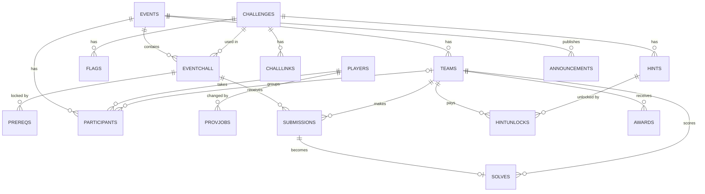

# DB2 data model

The tables behind the use cases in [02-use-cases.md](02-use-cases.md). The DDL is
in `DDL/AA0000nn.sql`, the change log in `DDL/$INFO.txt` and the names per
environment in `envs/t01.yaml`.

## Overview



The tables form three groups:

| Group | Tables | Changes |
|---|---|---|
| Library | CHALLENGES, FLAGS, HINTS, CHALLLINKS | Between events |
| Event setup | EVENTS, EVENTCHALL, PREREQS, ANNOUNCEMENTS, REFTABLES | Before and during an event |
| Play | PLAYERS, PROVJOBS, TEAMS, PARTICIPANTS, SUBMISSIONS, SOLVES, HINTUNLOCKS, AWARDS | Constantly during an event |

## Conventions

- `CCSID UNICODE`, GRAPHIC/VARGRAPHIC for text, and one tablespace per table.
- Every table ends with CREATEDBY, CREATEDDATE, UPDATEDBY and UPDATEDDATE. They
  are left out of the column lists below.
- Foreign keys are `ON DELETE RESTRICT`, so COBOL deletes children first.
- There are no CHECK constraints: value checks live in the `CTFMnnn` modules, as
  reason codes `08 0x`.
- One-character codes, with their meaning in the header of the module.

## Scoring

Scores are never stored. They are calculated from SOLVES, AWARDS and HINTUNLOCKS,
so a reversal or award can't leave a total out of date.

**Dynamic value** of a challenge with `n` solves:

```
k     = max(n - 1, 0)
value = max(MINPOINTS, ceiling(INITPOINTS + (MINPOINTS - INITPOINTS) * k^2 / DECAYSOLVES^2))
```

Everyone who solved a challenge gets its current value, so earlier solvers drop as
well. With 500 initial, 100 minimum and decay 5:

| Solves | 1 | 2 | 3 | 4 | 5 | 6 |
|---|---|---|---|---|---|---|
| Value | 500 | 484 | 436 | 356 | 244 | 100 |

**Team score** = solve values + awards - hint costs. It can go below zero.

**Ranking:** highest score first. On equal scores, whoever reached the score first
ranks higher, going by the last solve or positive award; hints and penalties don't
count as reaching a score.

**Freeze:** one query serves everyone, with the cutoff as a host variable:

| Reader | `:CUTOFF` |
|---|---|
| Visitor, player, frozen event | `FREEZETS` |
| Visitor, player, no freeze | `9999-12-31-23.59.59.999999` |
| Admin | `9999-12-31-23.59.59.999999` |

The challenge board (P4) uses the same first two parts of the query for its values.

### Leaderboard query

Shown with logical table names; in COBOL these are `TBCTFnnn`.

```sql
WITH SOLVECOUNT AS (
  SELECT CHALLENGEID, COUNT(*) AS N
    FROM SOLVES
   WHERE EVENTID = :EVENTID AND CREATEDDATE <= :CUTOFF
   GROUP BY CHALLENGEID),
CHALLVALUE AS (
  SELECT EC.CHALLENGEID,
         CASE WHEN EC.SCORETYPE = 'D'
              THEN MAX(EC.MINPOINTS, CAST(CEILING(
                     1E0 * (EC.MINPOINTS - EC.INITPOINTS)
                         * MAX(COALESCE(SC.N, 0) - 1, 0)
                         * MAX(COALESCE(SC.N, 0) - 1, 0)
                         / (EC.DECAYSOLVES * EC.DECAYSOLVES)
                     + EC.INITPOINTS) AS INTEGER))
              ELSE EC.INITPOINTS
         END AS POINTS
    FROM EVENTCHALL EC
    LEFT JOIN SOLVECOUNT SC ON SC.CHALLENGEID = EC.CHALLENGEID
   WHERE EC.EVENTID = :EVENTID),
SCORELINES AS (
  SELECT S.TEAMID, CV.POINTS, S.CREATEDDATE AS SCOREDATE, 1 AS ISSOLVE
    FROM SOLVES S
    JOIN CHALLVALUE CV ON CV.CHALLENGEID = S.CHALLENGEID
   WHERE S.EVENTID = :EVENTID AND S.CREATEDDATE <= :CUTOFF
  UNION ALL
  SELECT A.TEAMID, A.POINTS,
         CASE WHEN A.POINTS > 0 THEN A.CREATEDDATE END, 0
    FROM AWARDS A
   WHERE A.EVENTID = :EVENTID AND A.CREATEDDATE <= :CUTOFF
  UNION ALL
  SELECT H.TEAMID, 0 - H.COST, CAST(NULL AS TIMESTAMP), 0
    FROM HINTUNLOCKS H
   WHERE H.EVENTID = :EVENTID AND H.CREATEDDATE <= :CUTOFF),
TOTALS AS (
  SELECT TEAMID, SUM(POINTS) AS SCORE, MAX(SCOREDATE) AS LASTSCORE,
         SUM(ISSOLVE) AS SOLVECOUNT
    FROM SCORELINES
   GROUP BY TEAMID),
RANKED AS (
  SELECT T.TEAMID, T.TEAMNAME,
         COALESCE(TT.SCORE, 0) AS SCORE,
         COALESCE(TT.SOLVECOUNT, 0) AS SOLVECOUNT,
         ROW_NUMBER() OVER (
           ORDER BY COALESCE(TT.SCORE, 0) DESC,
                    COALESCE(TT.LASTSCORE,
                             TIMESTAMP('9999-12-31-23.59.59.999999')) ASC,
                    T.TEAMID ASC) AS RANKNO
    FROM TEAMS T
    LEFT JOIN TOTALS TT ON TT.TEAMID = T.TEAMID
   WHERE T.EVENTID = :EVENTID)
SELECT RANKNO, TEAMID, TEAMNAME, SCORE, SOLVECOUNT
  FROM RANKED
 WHERE RANKNO > :RANKSINCE
 ORDER BY RANKNO
 FETCH FIRST 20 ROWS ONLY
```

Every read recalculates the scores. All the joins are covered by indexes, and an
event has hundreds of teams at most, so v1 has no cache. If it turns out to be too
expensive, the public response can be cached for a few seconds without any
change to the model. Check the access path with EXPLAIN after the first load.

## Rules that need care

| Rule | How it is kept |
|---|---|
| One solve per team per challenge | Primary key of SOLVES; a duplicate (`-803`) is reported as "already solved" |
| Hint charged once | Primary key of HINTUNLOCKS |
| Cap on places | `UPDATE EVENTS SET PLAYERCOUNT = PLAYERCOUNT + 1 WHERE EVENTID = ? AND PLAYERCOUNT < MAXPLAYERS`: no row updated means full. A `COUNT(*)` could overshoot with simultaneous registrations |
| Maximum team size | Same technique with `TEAMS.MEMBERCOUNT` |
| One team per player per event | PARTICIPANTS has one row per event and player |
| Names unique regardless of case | Unique indexes on DISPLAYKEY and (EVENTID, TEAMKEY), so nobody can impersonate "Bob" as "BOB" on the public leaderboard |
| Registration and job row together | Same commit, before the job is submitted (S1) |
| Allowed RACF groups | COBOL checks `RACFGROUP` against `RACFGRP` in REFTABLES. A foreign key can't express this |
| Flags stay with admins | Only admin modules select FLAGS.FLAGVALUE and EVENTS.REGCODE |
| No cycles in prerequisites | Checked in COBOL when adding one |

## The one-time passphrase is not stored

The claim token and one-time passphrase come from one secret:

1. The backend generates a random claim token T (CPACF).
2. One-time passphrase = a value derived from SHA-256 of T, written as alternating
   letters and digits, so it always meets the default RACF rules.
3. The passphrase goes into the job. DB2 keeps only `CLAIMHASH`, a separate hash of
   T.
4. At activation, the registrant sends T. The backend checks it against the hash,
   derives the passphrase again and calls `EXEC CICS CHANGE PHRASE`.

Nothing in DB2 can be used to sign on, not even by a DBA, and there is nothing to
clear later. The job on the spool is then the only place the passphrase exists, so
its output has to be purged.

One consequence: a CREATE or RESET job can only be retried with a new claim token,
which the admin hands to the player.

## Tables

The column names are the current ones. `TITLE` is a reserved word in COBOL, so
`AA000022` renames it in CHALLENGES and ANNOUNCEMENTS.

### 001 REFTABLES (`TBCTF001`, `AA000004`)

Key/value lists: challenge categories (`CATEGORY`), allowed event RACF groups (`RACFGRP`), settings such as `CLAIMHRS` for S4 and `JOBMINS` for S3 (`SETTINGS`).

| Column | Type | Null | Meaning |
|---|---|---|---|
| **TABLEID** | GRAPHIC(8) |  | List name |
| **TABKEY** | GRAPHIC(8) |  | Key in the list |
| TABVALUE | VARGRAPHIC(255) | Yes | Value or description |

### 002 EVENTS (`TBCTF002`, `AA000005`)

One competition. Phase (upcoming/running/frozen/ended) is worked out from the timestamps, not stored. ARCHIVED (A) is a CLOSED event put away; only `CTFM540` sets it, and back.

| Column | Type | Null | Meaning |
|---|---|---|---|
| **EVENTID** | INTEGER identity |  | Key |
| EVENTNAME | VARGRAPHIC(100) |  | Name |
| DESCRIPTION | VARGRAPHIC(1000) | Yes | Public description |
| EVENTSTATUS | GRAPHIC(1) |  | D draft, P published, C closed, A archived |
| PLAYMODE | GRAPHIC(1) |  | I individual, T team |
| MAXTEAMSIZE | SMALLINT |  | 1 in individual mode |
| STARTTS | TIMESTAMP |  | Start |
| ENDTS | TIMESTAMP |  | End |
| FREEZETS | TIMESTAMP | Yes | Freeze; NULL = none or lifted |
| REGCODE | VARGRAPHIC(32) |  | Registration code; admin only |
| REGFROMTS | TIMESTAMP |  | Registration opens |
| REGTOTS | TIMESTAMP |  | Registration closes |
| MAXPLAYERS | INTEGER |  | Cap on places |
| PLAYERCOUNT | INTEGER |  | Places taken, including pending |
| RACFGROUP | GRAPHIC(8) | Yes | Extra RACF group, from `RACFGRP`; admin only |

Other indexes: (EVENTSTATUS, STARTTS).

### 003 PLAYERS (`TBCTF003`, `AA000006`)

Global player account. PLAYERID doubles as the registration ID.

| Column | Type | Null | Meaning |
|---|---|---|---|
| **PLAYERID** | INTEGER identity |  | Key; also the registration ID |
| RACFUSERID | GRAPHIC(8) |  | Generated: `CTF` + 4 digits from the sequence, so 7 characters. Each environment has its own range of the sequence (`PLAYERS_SEQ_START`/`MAX` in `envs/*.yaml`: T01 1-4999, T02 5001-9999), because they share one RACF database |
| DISPLAYNAME | VARGRAPHIC(30) |  | Name as typed |
| DISPLAYKEY | VARGRAPHIC(30) |  | DISPLAYNAME in upper case, for uniqueness |
| PLAYERSTATUS | GRAPHIC(1) |  | P pending, R ready, A active, F failed, V revoked, X deleted |
| CLAIMHASH | BINARY(32) | Yes | SHA-256 of the claim token; NULL once used |
| CLAIMEXPIRES | TIMESTAMP | Yes | After this, S4 expires the account |

Other indexes: unique (RACFUSERID); unique (DISPLAYKEY); (PLAYERSTATUS, CLAIMEXPIRES).
Sequence `SQCTF003` supplies the userid digits, up to 9999.

### 004 PROVJOBS (`TBCTF004`, `AA000007`)

One RACF change for one player; the audit trail of everything done to RACF.

| Column | Type | Null | Meaning |
|---|---|---|---|
| **PROVJOBID** | INTEGER identity |  | Key; also encoded in the job name |
| PLAYERID | INTEGER |  | Player |
| EVENTID | INTEGER | Yes | Event, for CONNECT and REMOVE |
| PROVACTION | GRAPHIC(1) |  | C create, N connect, M remove, P reset, V revoke, U resume, X delete |
| RACFGROUP | GRAPHIC(8) | Yes | Group, for CONNECT and REMOVE |
| JOBSTATUS | GRAPHIC(1) |  | N new, Q queued for the batch, S submitted, D done, F failed |
| JESJOBID | GRAPHIC(8) | Yes | JES job ID, if known |
| SUBMITTEDDATE | TIMESTAMP | Yes | Submitted |
| COMPLETEDDATE | TIMESTAMP | Yes | Finished |
| JOBRC | SMALLINT | Yes | Return code |
| JOBMESSAGE | VARGRAPHIC(72) | Yes | Result text |
| RETRYCOUNT | SMALLINT |  | Retries (A6) |
| JOBHASH | BINARY(32) | Yes | Hash of the job token, for actions without a claim token; NULL once submitted (`AA000026`) |

Other indexes: (PLAYERID); (JOBSTATUS, CREATEDDATE).
Foreign keys: (PLAYERID) -> PLAYERS; (EVENTID) -> EVENTS.

### 005 TEAMS (`TBCTF005`, `AA000008`)

The unit that scores. Team of one in individual events, named after the player.

| Column | Type | Null | Meaning |
|---|---|---|---|
| **TEAMID** | INTEGER identity |  | Key |
| EVENTID | INTEGER |  | Event |
| TEAMNAME | VARGRAPHIC(30) |  | Name as typed |
| TEAMKEY | VARGRAPHIC(30) |  | TEAMNAME in upper case, for uniqueness |
| JOINCODE | GRAPHIC(12) |  | Generated join code; never public |
| CAPTAINID | INTEGER |  | Captain |
| MEMBERCOUNT | SMALLINT |  | Members, for the size check |

Other indexes: unique (EVENTID, TEAMKEY); unique (EVENTID, JOINCODE); (CAPTAINID).
Foreign keys: (EVENTID) -> EVENTS; (CAPTAINID) -> PLAYERS.

### 006 PARTICIPANTS (`TBCTF006`, `AA000009`)

A place in an event.

| Column | Type | Null | Meaning |
|---|---|---|---|
| **EVENTID** | INTEGER |  | Event |
| **PLAYERID** | INTEGER |  | Player |
| TEAMID | INTEGER | Yes | NULL = no team yet |
| PARTSTATUS | GRAPHIC(1) |  | P pending (waiting for a job), A active |

Other indexes: (PLAYERID); (TEAMID).
Foreign keys: (EVENTID) -> EVENTS; (PLAYERID) -> PLAYERS; (TEAMID) -> TEAMS.

### 007 CHALLENGES (`TBCTF007`, `AA000010`)

The reusable library. Uses an 8K buffer pool for the long description.

| Column | Type | Null | Meaning |
|---|---|---|---|
| **CHALLENGEID** | INTEGER identity |  | Key |
| CHALLENGETITLE | VARGRAPHIC(100) |  | Title |
| CATEGORY | GRAPHIC(8) |  | Key in `CATEGORY` |
| DESCRIPTION | VARGRAPHIC(3000) |  | Text shown to players |
| CHALLENGETYPE | GRAPHIC(1) |  | S static; only value in v1 |
| VERIFIERPGM | GRAPHIC(8) | Yes | For live verification later; NULL in v1 |

Other indexes: (CATEGORY).

### 008 FLAGS (`TBCTF008`, `AA000011`)

Accepted answers; a challenge can have several. Plain text, in admin schemas only.

| Column | Type | Null | Meaning |
|---|---|---|---|
| **FLAGID** | INTEGER identity |  | Key |
| CHALLENGEID | INTEGER |  | Challenge |
| FLAGVALUE | VARGRAPHIC(255) |  | The flag |
| CASESENSITIVE | GRAPHIC(1) |  | Y or N |

Other indexes: (CHALLENGEID).
Foreign keys: (CHALLENGEID) -> CHALLENGES.

### 009 HINTS (`TBCTF009`, `AA000012`)

Paid help for a challenge.

| Column | Type | Null | Meaning |
|---|---|---|---|
| **HINTID** | INTEGER identity |  | Key |
| CHALLENGEID | INTEGER |  | Challenge |
| SORTORDER | SMALLINT |  | Display order |
| HINTTEXT | VARGRAPHIC(1000) |  | Hidden until unlocked |
| COST | INTEGER |  | Points deducted |

Other indexes: (CHALLENGEID, SORTORDER).
Foreign keys: (CHALLENGEID) -> CHALLENGES.

### 010 CHALLLINKS (`TBCTF010`, `AA000013`)

Links to files hosted elsewhere.

| Column | Type | Null | Meaning |
|---|---|---|---|
| **LINKID** | INTEGER identity |  | Key |
| CHALLENGEID | INTEGER |  | Challenge |
| LINKNAME | VARGRAPHIC(60) |  | Text shown |
| LINKURL | VARGRAPHIC(500) |  | URL |

Other indexes: (CHALLENGEID).
Foreign keys: (CHALLENGEID) -> CHALLENGES.

### 011 EVENTCHALL (`TBCTF011`, `AA000014`)

A library challenge in an event, with its scoring there.

| Column | Type | Null | Meaning |
|---|---|---|---|
| **EVENTID** | INTEGER |  | Event |
| **CHALLENGEID** | INTEGER |  | Challenge |
| SCORETYPE | GRAPHIC(1) |  | S static, D dynamic |
| INITPOINTS | INTEGER |  | Value, or initial value if dynamic |
| MINPOINTS | INTEGER | Yes | Dynamic only: lowest value |
| DECAYSOLVES | INTEGER | Yes | Dynamic only: decay, > 0 |
| ISVISIBLE | GRAPHIC(1) |  | Y or N |
| SORTORDER | SMALLINT |  | Display order |
| MAXATTEMPTS | SMALLINT | Yes | Wrong attempts per team; NULL = no limit |

Other indexes: (CHALLENGEID).
Foreign keys: (EVENTID) -> EVENTS; (CHALLENGEID) -> CHALLENGES.

### 012 PREREQS (`TBCTF012`, `AA000015`)

Challenge CHALLENGEID stays locked until REQCHALLENGEID is solved. Per event, because events choose subsets.

| Column | Type | Null | Meaning |
|---|---|---|---|
| **EVENTID** | INTEGER |  | Event |
| **CHALLENGEID** | INTEGER |  | Locked challenge |
| **REQCHALLENGEID** | INTEGER |  | Required challenge |

Other indexes: (EVENTID, REQCHALLENGEID).
Foreign keys: (EVENTID, CHALLENGEID) -> EVENTCHALL; (EVENTID, REQCHALLENGEID) -> EVENTCHALL.

### 013 SUBMISSIONS (`TBCTF013`, `AA000016`)

Every recorded attempt. CREATEDDATE is the attempt time.

| Column | Type | Null | Meaning |
|---|---|---|---|
| **SUBMISSIONID** | INTEGER identity |  | Key |
| EVENTID | INTEGER |  | Event |
| CHALLENGEID | INTEGER |  | Challenge |
| TEAMID | INTEGER |  | Team |
| PLAYERID | INTEGER |  | Who submitted |
| SUBMITTEDTEXT | VARGRAPHIC(255) |  | After trimming; admin only |
| ISCORRECT | GRAPHIC(1) |  | Y or N |
| REVERSEDBY | GRAPHIC(8) | Yes | Admin who reversed the solve |
| REVERSEDDATE | TIMESTAMP | Yes | When |
| REVERSEREASON | VARGRAPHIC(255) | Yes | Why |

Other indexes: (EVENTID, CHALLENGEID, TEAMID, ISCORRECT); (EVENTID, CREATEDDATE); (TEAMID); (PLAYERID).
Foreign keys: (EVENTID, CHALLENGEID) -> EVENTCHALL; (TEAMID) -> TEAMS; (PLAYERID) -> PLAYERS.

### 014 SOLVES (`TBCTF014`, `AA000017`)

The primary key is what makes a double score impossible. CREATEDDATE is the solve time. A reversal deletes the row.

| Column | Type | Null | Meaning |
|---|---|---|---|
| **EVENTID** | INTEGER |  | Event |
| **CHALLENGEID** | INTEGER |  | Challenge |
| **TEAMID** | INTEGER |  | Team |
| PLAYERID | INTEGER |  | Who solved it |
| SUBMISSIONID | INTEGER |  | The attempt |

Other indexes: (EVENTID, TEAMID); (EVENTID, CHALLENGEID, CREATEDDATE); (TEAMID); (PLAYERID); (SUBMISSIONID).
Foreign keys: (EVENTID, CHALLENGEID) -> EVENTCHALL; (TEAMID) -> TEAMS; (PLAYERID) -> PLAYERS; (SUBMISSIONID) -> SUBMISSIONS.

### 015 HINTUNLOCKS (`TBCTF015`, `AA000018`)

A hint a team paid for. COST is a copy, so later edits to the hint change nothing.

| Column | Type | Null | Meaning |
|---|---|---|---|
| **EVENTID** | INTEGER |  | Event |
| **HINTID** | INTEGER |  | Hint |
| **TEAMID** | INTEGER |  | Team |
| PLAYERID | INTEGER |  | Who unlocked it |
| COST | INTEGER |  | Cost at that moment |

Other indexes: (EVENTID, TEAMID); (HINTID); (TEAMID); (PLAYERID).
Foreign keys: (EVENTID) -> EVENTS; (HINTID) -> HINTS; (TEAMID) -> TEAMS; (PLAYERID) -> PLAYERS.

### 016 AWARDS (`TBCTF016`, `AA000019`)

Manual points, positive or negative. CREATEDDATE decides how it relates to the freeze.

| Column | Type | Null | Meaning |
|---|---|---|---|
| **AWARDID** | INTEGER identity |  | Key |
| EVENTID | INTEGER |  | Event |
| TEAMID | INTEGER |  | Team |
| POINTS | INTEGER |  | Not zero |
| REASON | VARGRAPHIC(255) |  | Shown to the team |

Other indexes: (EVENTID, TEAMID); (TEAMID).
Foreign keys: (EVENTID) -> EVENTS; (TEAMID) -> TEAMS.

### 017 ANNOUNCEMENTS (`TBCTF017`, `AA000020`)

Messages to an event's players. CREATEDDATE is the publish time.

| Column | Type | Null | Meaning |
|---|---|---|---|
| **ANNOUNCEID** | INTEGER identity |  | Key |
| EVENTID | INTEGER |  | Event |
| ANNOUNCETITLE | VARGRAPHIC(100) |  | Title |
| BODY | VARGRAPHIC(1000) |  | Text |

Other indexes: (EVENTID, CREATEDDATE).
Foreign keys: (EVENTID) -> EVENTS.

## From use case to table

Endpoints are in [04-api.md](04-api.md).

| Use case | Tables written | Tables read |
|---|---|---|
| V1 Browse events | | EVENTS |
| V2 View leaderboard | | EVENTS, EVENTCHALL, TEAMS, SOLVES, AWARDS, HINTUNLOCKS |
| R1 Register | PLAYERS, PARTICIPANTS, TEAMS, EVENTS, PROVJOBS | EVENTS |
| R2 Follow status | | PLAYERS |
| R3 Choose passphrase | PLAYERS | PLAYERS |
| P1 Sign in | | (RACF) |
| P2 Join event | PARTICIPANTS, TEAMS, EVENTS, PROVJOBS | EVENTS, PLAYERS |
| P3 Change passphrase | | (RACF) |
| P4 Challenge board | | EVENTCHALL, CHALLENGES, SOLVES, PREREQS, PARTICIPANTS |
| P5 View challenge | | CHALLENGES, CHALLLINKS, HINTS, HINTUNLOCKS, EVENTCHALL, PREREQS, SOLVES, SUBMISSIONS |
| P6 Submit flag | SUBMISSIONS, SOLVES | FLAGS, EVENTCHALL, PREREQS, PARTICIPANTS |
| P7 Unlock hint | HINTUNLOCKS | HINTS, PARTICIPANTS |
| P8 Own progress | | TEAMS, SOLVES, HINTUNLOCKS, AWARDS, EVENTCHALL |
| P9 Announcements | | ANNOUNCEMENTS, PARTICIPANTS |
| T1 Create team | TEAMS, PARTICIPANTS | EVENTS |
| T2 Join team | TEAMS, PARTICIPANTS | EVENTS |
| T3 Leave team | TEAMS, PARTICIPANTS | EVENTS |
| T4 Captain | TEAMS, PARTICIPANTS | EVENTS |
| A1 Event lifecycle | EVENTS | REFTABLES, EVENTCHALL |
| A2 Library | CHALLENGES, FLAGS, HINTS, CHALLLINKS | REFTABLES, EVENTCHALL, HINTUNLOCKS |
| A3 Compose event | EVENTCHALL, PREREQS | FLAGS, SOLVES, SUBMISSIONS |
| A4 Monitor, correct | SOLVES, SUBMISSIONS | as V2 |
| A5 Manage players | PLAYERS, PROVJOBS | PLAYERS |
| A6 Follow jobs | PROVJOBS, PLAYERS | PROVJOBS |
| A7 Awards | AWARDS | TEAMS |
| A8 Announcements | ANNOUNCEMENTS | EVENTS |
| A9 Close event | EVENTS, PROVJOBS | PARTICIPANTS |
| A10 Archive event | EVENTS | EVENTS |
| S1 Submit job | PROVJOBS | PROVJOBS |
| S2 Record result | PROVJOBS, PLAYERS, PARTICIPANTS | PROVJOBS |
| S3 Scheduled batch | PROVJOBS | PROVJOBS |
| S4 Expire registrations | PLAYERS, PROVJOBS, EVENTS, PARTICIPANTS | PLAYERS |
